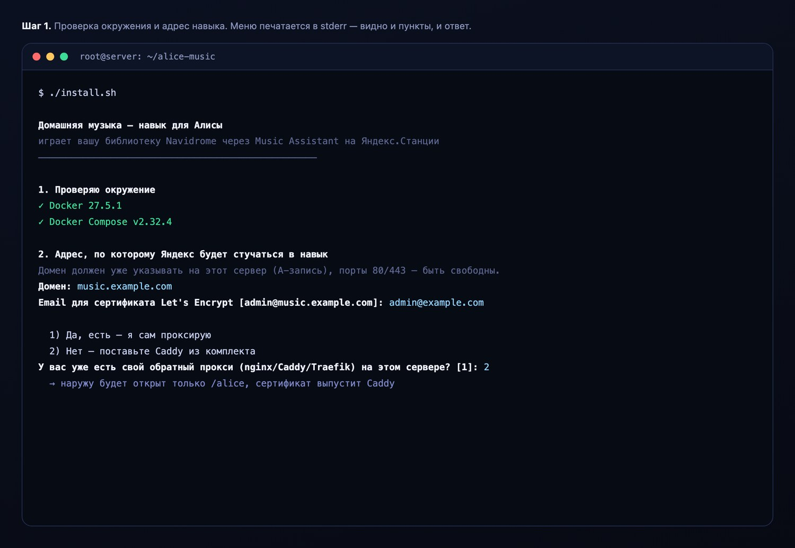
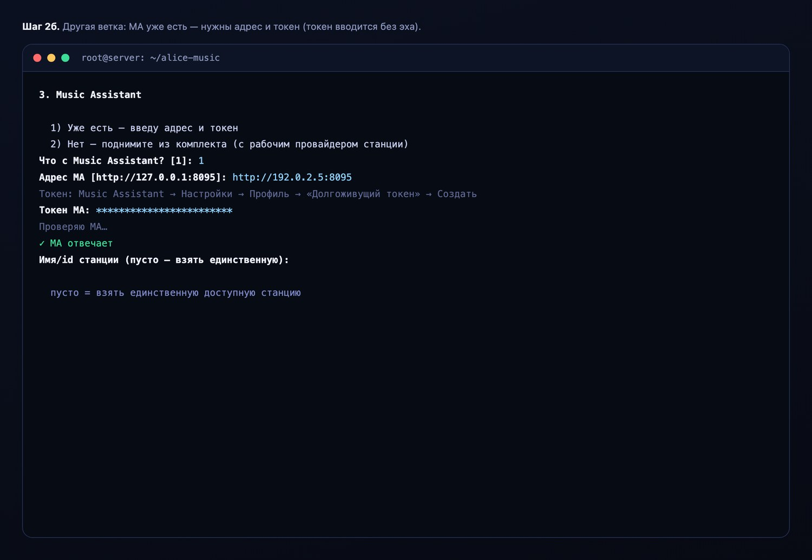
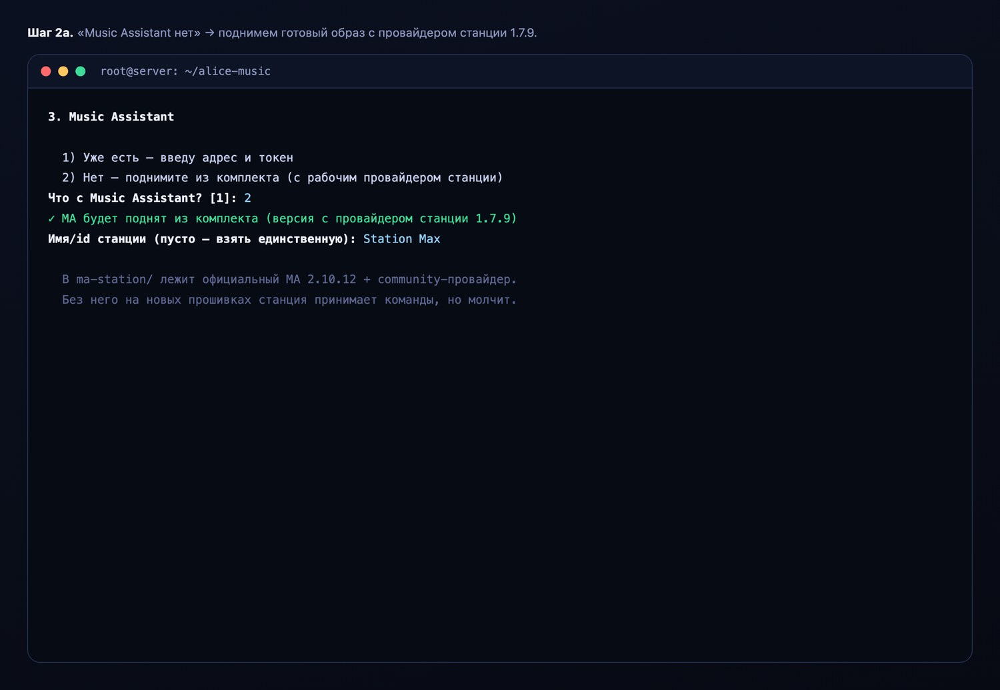
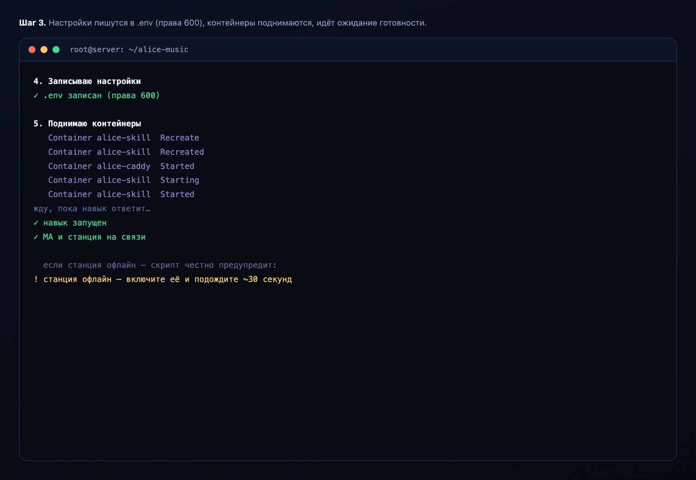
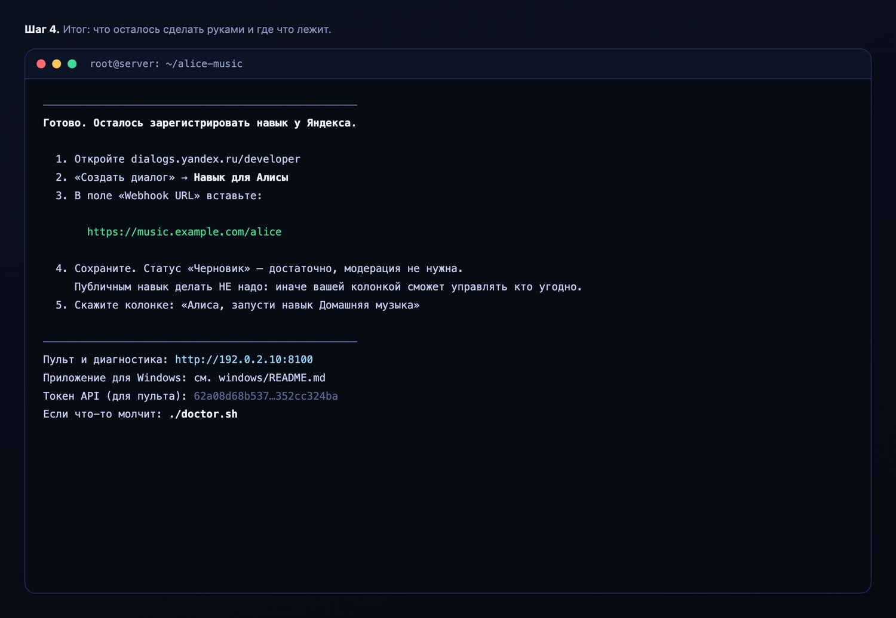
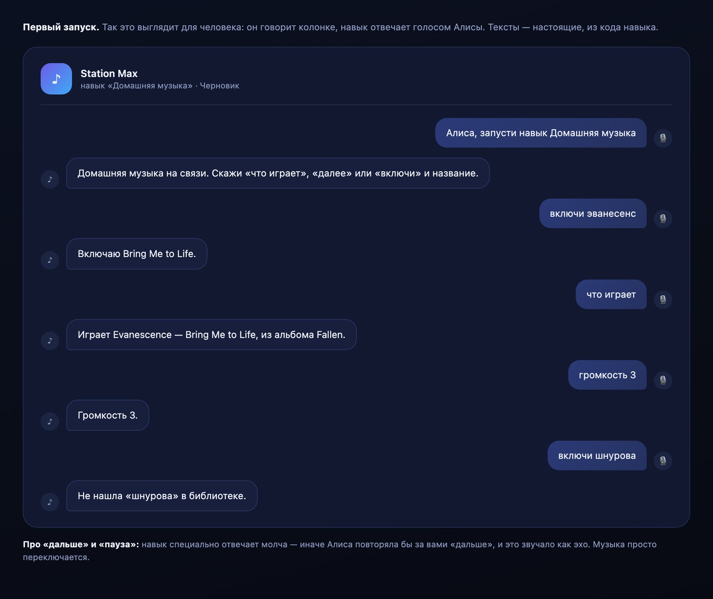
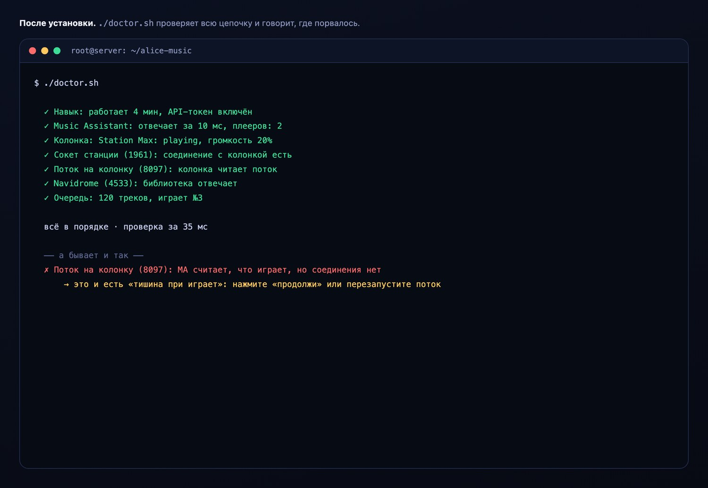
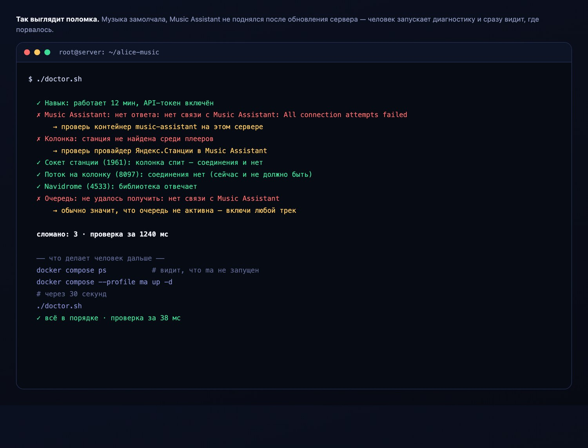
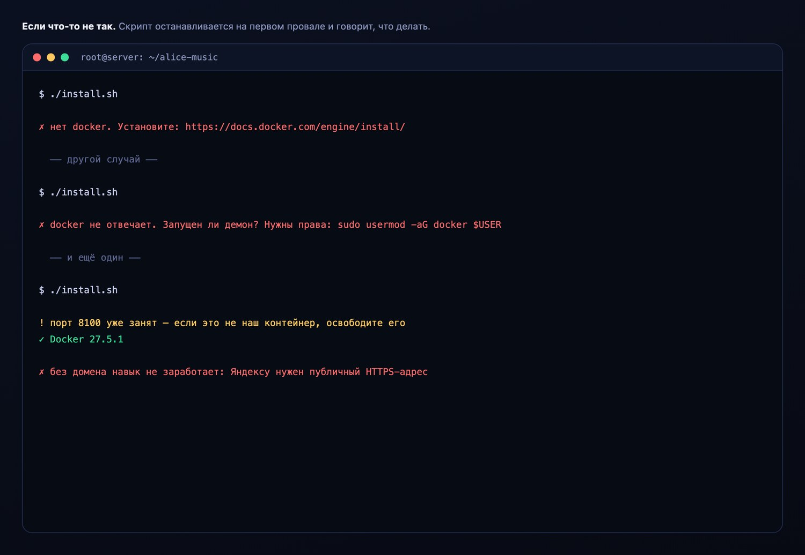

# Подробное руководство по установке

Для кого: вы ставите систему первый раз и хотите понимать, что происходит на каждом шаге.
README — это быстрый старт, здесь — то же самое, но с объяснениями, скриншотами и разбором
мест, где обычно спотыкаются.

Время: **~30 минут** на сервер и Music Assistant плюс **~10 минут** на Яндекс.Диалоги.

---

## 1. Что мы собираем

```
  Яндекс.Станция (колонка)
        │  голос: «Алиса, запусти навык Домашняя музыка»
        ▼
  Яндекс.Диалоги ──HTTPS──► навык «Домашняя музыка» (этот проект, :8100)
                                    │  JSON-RPC
                                    ▼
                            Music Assistant (:8095)
                                    │  библиотека + аудиопоток
                                    ▼
                               Navidrome (:4533)
                                    │
                                    ▼
                          ваша папка с музыкой
```

| Компонент | Зачем | Где живёт |
|---|---|---|
| Навык | понимает голос, отдаёт команды MA, ведёт журнал | ваш сервер, контейнер `alice-skill` |
| Music Assistant | умеет играть на станции, держит очередь | ваш сервер |
| Провайдер Яндекс.Станции | связывает MA с колонкой (локальный протокол Glagol) | внутри MA |
| Navidrome | отдаёт библиотеку и обложки | у вас уже есть |
| Caddy / ваш прокси | публичный HTTPS для Яндекса | ваш сервер |

**Чего эта схема не делает:** не хранит музыку в облаке, не публикует её, не управляет
чужими колонками. Навык — только пульт.

---

## 2. Что понадобится

| | Требование |
|---|---|
| Сервер | Linux (Ubuntu/Debian подойдёт), Docker + Docker Compose v2, ≥2 ГБ RAM, ≥1 ГБ диска |
| Сеть | **домен**, A-запись которого указывает на сервер; открытые 80 и 443 |
| Музыка | Navidrome (или любой Subsonic-совместимый сервер) с просканированной библиотекой |
| Колонка | Яндекс.Станция, привязанная к вашему аккаунту |
| Аккаунт | Яндекс-аккаунт (для провайдера станции в MA) |

> ⚠️ Без домена не заработает: Яндекс ходит в навык **только по публичному HTTPS**.
> IP-адрес в поле «Webhook URL» Яндекс не примет.

---

## 3. Подготовка сервера

### 3.1 Docker

```bash
docker --version            # нужен 20.10+
docker compose version      # нужен v2 (плагин, а не docker-compose v1)
```

Если чего-то нет — [официальная инструкция](https://docs.docker.com/engine/install/):

```bash
curl -fsSL https://get.docker.com | sh
sudo usermod -aG docker $USER    # затем перелогиниться
```

### 3.2 Домен

1. У регистратора добавьте **A-запись**: `music.example.com → IP вашего сервера`.
2. Подождите 5–15 минут и проверьте:

```bash
dig +short music.example.com     # должен вернуть ваш IP
```

### 3.3 Порты

Нужны свободные **80** и **443** (для Caddy и сертификата) и **8100** (навык).

```bash
ss -ltn | grep -E ':(80|443|8100) '
```

Если на 80/443 уже висит ваш nginx/Caddy/Traefik — ничего не трогайте, при установке
ответьте «Да, есть свой прокси», а затем добавьте блок проксирования (см. 3.4).

### 3.4 Если у вас уже есть свой прокси

При установке выберите «Да, есть» и пропишите у себя проксирование **только пути `/alice`**.
Пример для Caddy:

```caddy
music.example.com {
    encode gzip
    handle_path /alice/* {
        reverse_proxy 127.0.0.1:8100
    }
    handle {
        respond "alice-music: публично доступен только /alice" 404
    }
}
```

Пример для nginx:

```nginx
location /alice/ {
    proxy_pass http://127.0.0.1:8100/;
    proxy_set_header Host $host;
    proxy_set_header X-Source "alice";
}
location / { return 404; }
```

---

## 4. Установка

```bash
git clone https://github.com/<ваш-ник>/alice_drom.git
cd alice_drom
./install.sh
```

### 4.1 Проверка окружения и адрес



Скрипт проверяет Docker, Compose, память и занятые порты, затем спрашивает домен и email
для сертификата. Домен вводите **без** `https://` — только имя.

### 4.2 Music Assistant: две ветки

**Если MA у вас уже есть** — введите адрес и токен. Токен берётся в MA:
*Настройки → Профиль → «Долгоживущий токен» → Создать* (в разных версиях MA раздел
может называться «Безопасность»). При вводе токена символы не отображаются — это нормально.



**Если MA нет** — выберите второй пункт: поднимется готовый образ с рабочим провайдером
станции (в обычном MA провайдер старый и на актуальных прошивках станция молчит).



### 4.3 Запуск



Скрипт запишет `.env` (права 600), соберёт и запустит контейнеры, дождётся ответа навыка
и проверит связь с MA и станцией. Если станция выключена — предупредит, но установку не сорвёт.

### 4.4 Что дальше



В конце скрипт печатает адрес вебхука и напоминает про Яндекс.Диалоги (раздел 6).
Диагностика в любой момент:

```bash
./doctor.sh
```

---

## 5. Music Assistant

Откройте `http://<сервер>:8095`. Первый вход — создание локального администратора MA.

### 5.1 Подключить библиотеку Navidrome

1. **Настройки → Провайдеры → «+ Добавить провайдера»**.
2. Найдите **Subsonic** (он же OpenSubsonic — протокол, по которому Navidrome отдаёт музыку).
3. Заполните:
   - **URL**: `https://music.example.com` (адрес вашего Navidrome, без `/rest`);
   - **Пользователь / Пароль**: логин и пароль Navidrome;
   - имя библиотеки — любое, например «Домашняя».
4. Сохраните и дождитесь синхронизации — в разделе «Библиотека» появятся исполнители.

> Если Navidrome отдаёт самоподписанный сертификат — включите в настройках провайдера
> опцию проверки SSL «не проверять» (только внутри домашней сети!).

### 5.2 Провайдер Яндекс.Станции

В том же списке провайдеров откройте **Yandex Station**:

1. Введите логин и пароль Яндекса (или войдите по QR, если предлагает).
2. Если включена двухфакторная защита — MA попросит код: он придёт на телефон.
3. После входа появится ваша станция — она же станет плеером `ys_...` в разделе «Плееры».

> ⚠️ Логин и пароль вводятся **в Music Assistant**, а не в наш навык и не в приложение.
> Навык их не видит.

Проверка: в MA откройте станцию и нажмите «Проверить»/включите любой трек — колонка должна
заиграть. Если молчит, а MA показывает «играет» — значит провайдер не тот: возьмите образ из
`ma-station/` (в нём версия 1.7.9, которая работает на новых прошивках).

### 5.3 Токен для навыка

*Настройки → Профиль → «Долгоживущий токен» → Создать* (или «Безопасность») → скопируйте.
Он уже прописан в `.env` инсталлером (если вы выбрали ветку «MA у меня есть» — проверьте,
что в `.env` тот же токен).

После любых изменений в `.env`:

```bash
docker compose up -d --force-recreate
```

---

## 6. Яндекс.Диалоги

1. Откройте **dialogs.yandex.ru/developer** и войдите тем же аккаунтом, к которому привязана станция.
2. **«Создать диалог»** → тип **«Навык для Алисы»**.
3. Заполните:
   - **Имя навыка**: **на ваш выбор**, например `Домашняя музыка` — именно его вы будете
     называть голосом. Такое же имя впишите в `.env` (`SKILL_NAME`), чтобы приветствие
     и разбор фраз совпадали;
   - **Backend**: `Webhook URL` → `https://music.example.com/alice`.
4. Нажмите **«Сохранить»**, затем кнопку проверки — Яндекс отправит `ping`, навык должен ответить `pong`.
5. Нажмите **«Опубликовать»** и дождитесь статуса **«Опубликован»**.

> ⚠️ **Критично: навык должен быть опубликован.** В статусе «Черновик» Яндекс
> отвечает на запросы, но **не запускает воспроизведение** — со стороны это
> выглядит как «Алиса понимает команду, но музыка молчит». Проверено на живой
> колонке. Модерация для такого навыка формальная: он не попадает в каталог,
> но и не блокируется.

### 6.0 Защита после публикации: только ваш аккаунт

Опубликованный навык может запустить **любой** пользователь Алисы — и управлять
вашей колонкой. Поэтому сразу после публикации ограничьте доступ:

1. Узнайте свой `user_id`. Попросите колонку что-нибудь сделать, например
   «Алиса, запусти навык Домашняя музыка», и посмотрите лог:

   ```bash
   docker compose logs skill | grep user_id
   ```

   В строке будет `user_id=...` — это и есть ваш идентификатор.

2. Впишите его в `.env`:

   ```bash
   OWNER_USER_ID=1234567890123456789
   docker compose up -d --force-recreate
   ```

3. Проверьте в разделе «Проверка» приложения: пункт **«Доступ»** станет зелёным
   («только для вашего аккаунта»). Чужим навык ответит «Этот навык настроен на
   другого пользователя».

Пока `OWNER_USER_ID` пуст, навык слушает всех — это допустимо только для
приватного тестирования, но не для опубликованного.

Если интерфейс Диалогов поменялся — ищите поле **Webhook URL** и тип «Навык для Алисы»;
остальное не критично.

### 6.1 Имя навыка можно поменять

Имя — не константа проекта, а ваша настройка. Оно живёт в двух местах и должно совпадать:

| Где | Что задаёт |
|---|---|
| Яндекс.Диалоги, поле «Имя навыка» | что вы произносите: «Алиса, запусти навык …» |
| `.env` на сервере, `SKILL_NAME` | приветствие в ответ и разбор фразы «запусти навык <имя>, включи …» |

Порядок смены:

1. В Диалогах откройте навык и измените имя → «Сохранить».
2. На сервере поправьте `.env`: `SKILL_NAME=Моя радиоточка`.
3. `docker compose up -d --force-recreate`.

Учтите: Алиса узнаёт навык по имени, поэтому старое имя перестанет работать сразу после
переименования в Диалогах. Если хочется «человеческое» произношение — выбирайте имя без
сокращений и латиницы: «Домашняя музыка», «Моя радиоточка», «Музыка дома».

### 6.2 Проверка голосом



Скажите: **«Алиса, запусти навык Домашняя музыка»**. Дальше:

| Скажите | Что будет |
|---|---|
| «включи эванесенс» | найдёт и включит |
| «что играет» | скажет исполнителя, трек и альбом |
| «громкость 3» | поставит громкость |
| «дальше», «пауза», «продолжи», «стоп» | транспорт (отвечает молча — так задумано) |
| «перемешай», «повтори», «избранное», «похожее» | режимы и подборки |
| «перемотай на минуту» | позиция в треке |

---

## 7. Пульт для Windows (необязательно)

1. Скачайте `MusicControl.exe` из раздела **Releases** (около 110 КБ, .NET Framework 4.8
   уже есть в Windows 10/11) — или соберите: `cd windows && dotnet build -c Release`.
2. Запустите. При первом запуске откроется раздел **«Настройки»**:
   - **Адрес сервера**: `192.168.1.10:8100` (или адрес вашего сервера);
   - **Токен API**: значение `API_TOKEN` из `.env` (можно посмотреть командой
     `grep API_TOKEN .env` на сервере);
   - **«Проверить связь»** → должно появиться «Сервер отвечает · станция на связи»;
   - **«Сохранить»** — конфиг создастся рядом с exe.
3. Дальше: «Домой» (плеер и журнал), «Проверка» (диагностика), «Очередь» (что играет дальше).

Приложение работает только в локальной сети — порт 8100 наружу не публикуется.

---

## 8. Обслуживание

### Обновление

```bash
cd alice_drom
git pull
docker compose up -d --build
./doctor.sh
```

### Бэкап

Достаточно двух вещей:

```bash
cp .env ~/alice-env.backup        # токены и адреса
docker run --rm -v ma-data:/data -v $PWD:/backup alpine tar czf /backup/ma-data.tgz /data
```

### Логи

```bash
docker compose logs -f skill      # навык
docker compose logs -f ma         # Music Assistant
docker compose logs -f caddy      # сертификаты и прокси
```

---

## 9. Если сломалось

Первое действие всегда одно:

```bash
./doctor.sh
```



При проблеме вывод краснеет и подсказывает причину:



| Симптом | Причина | Что делать |
|---|---|---|
| Алиса «не понимает» после запуска навыка | неверный webhook или сертификат | проверьте `ping` в Диалогах, откройте `https://домен/alice/health` в браузере |
| Навык отвечает, но музыка не играет | станция офлайн / провайдер молчит | `./doctor.sh` → проверьте «Колонка» и «Поток (8097)» |
| `✗ Music Assistant` в диагностике | контейнер MA не поднялся | `docker compose --profile ma up -d`, смотрите логи |
| `401` в приложении | неверный `API_TOKEN` | сверьте токен в настройках приложения и в `.env` |
| `502 Bad Gateway` | навык не слушает 8100 | `docker compose ps`, логи `skill` |
| «играет», а звука нет | провайдер станции отстал от прошивки | пересоберите MA из `ma-station/` |
| станция «спит», команды не доходят | колонка отключилась от локального сокета | включите её и подождите ~30 секунд |
| после смены `.env` ничего не изменилось | контейнер не пересоздан | `docker compose up -d --force-recreate` |

Типичные ошибки установки (нет Docker, занятый порт, отсутствует домен):



---

## 10. Безопасность

- Наружу открыт **только** путь `/alice` — его проксирует Caddy и он проверяет подпись Яндекса.
- `API_TOKEN` защищает `/api/*` (приложение и веб-пульт). Порт 8100 держите внутри сети.
- Секреты живут в `.env` (права 600) и в конфиге приложения на вашем ПК — в git они не попадают.
- Логин Яндекса хранится в Music Assistant, а не в навыке.
- Если токен утёк: сгенерируйте новый (`openssl rand -hex 24`), впишите в `.env`,
  `docker compose up -d --force-recreate`, затем обновите его в приложении.

---

## 11. Частые вопросы

**Алиса не находит навык по имени.**
Проверьте, что навык сохранён и имя совпадает с тем, что написано в Диалогах; перезапустите
Алису («Алиса, обнови навыки») или назовите точнее: «Алиса, запусти навык Домашняя музыка».

**Можно ли назвать навык иначе?**
Да, имя выбираете вы (раздел 6.1). После переименования не забудьте `SKILL_NAME` в `.env`
и `docker compose up -d --force-recreate`.

**`Draft is not allowed to deploy`.**
Это сообщение про автосоздание навыка через API: Яндекс не деплоит черновики.
Создайте навык руками в Диалогах и нажмите «Опубликовать» — для работы
воспроизведения публикация обязательна (см. раздел 6).

**Навык отвечает, но музыка не играет.**
Первым делом проверьте статус в Диалогах: если там «Черновик» — опубликуйте.
Дальше — `./doctor.sh`: он покажет, жива ли станция и идёт ли поток на 8097.

**В Яндексе не проходит `ping`.**
Откройте `https://ваш-домен/alice/health` в браузере. Если ошибка — смотрите Caddy и DNS:
домен должен резолвиться на этот сервер, а сертификат — быть валидным.

**Несколько колонок.**
В `.env` укажите `PLAYER_NAME=<id или имя>` — иначе навык возьмёт единственную доступную станцию.
Если станций несколько, без `PLAYER_NAME` он может выбрать не ту.

**Можно ли слушать с телефона?**
Да, через Navidrome или приложения MA. Но навык управляет только колонкой.

**Работает ли без интернета?**
Нет: Яндекс.Диалоги и вход в аккаунт Яндекса — облачные. Музыка при этом играет с вашего сервера.
